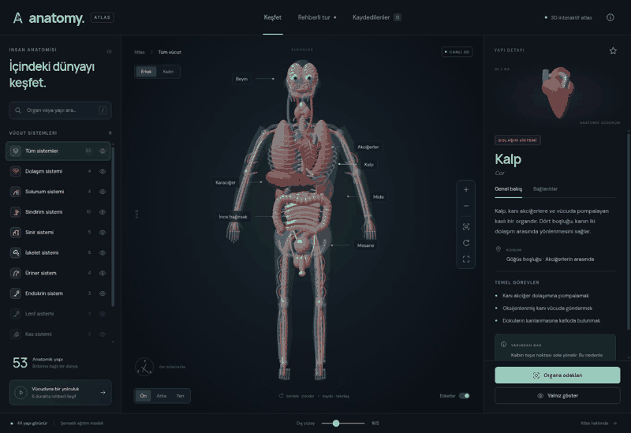

<div align="center">

# Anatomy
### Explore the human body, one structure at a time.

An interactive 3D anatomy atlas built with Three.js.

**63 selectable structures · 11 body systems · 22 reproductive structures**

[**Launch the atlas ↗**](https://serkansonmzz.github.io/anatomy/) · [Quick start](#quick-start) · [Explore](#explore) · [Development](#development)

[](https://github.com/serkansonmzz/anatomy/actions/workflows/pages.yml)


[](https://serkansonmzz.github.io/anatomy/)

<sub>Actual application capture. The atlas interface and anatomical descriptions are currently in Turkish.</sub>

</div>

## Explore

| Feature | Experience |
| --- | --- |
| **Interactive anatomy** | Rotate, zoom, select structures and read their functions, locations and relationships. |
| **System layers** | Explore organs, vessels, nerves, bones and other structures across 11 body systems. |
| **Focus & isolation** | Move the camera to an organ or hide surrounding structures for a closer look. |
| **Reproductive anatomy** | Switch between male and female anatomy and explore 22 selectable structures. |
| **Cutaway views** | Reveal schematic internal layers, including testicular tubules, erectile tissues, uterine layers and ovarian follicles. |
| **Guided discovery** | Follow a six-stop tour or save structures to a personal browser-local collection. |
| **Portable viewing** | Generate a standalone HTML edition with bundled scripts and geometry. |

### Controls

**Drag** to orbit · **Scroll** to zoom · **Click** a structure to inspect it.

| Shortcut | Action |
| --- | --- |
| `/` | Search by Turkish or Latin name |
| `R` | Reset the view |
| `Esc` | Exit focus and close mobile panels |

For reproductive cutaways, select **Üreme sistemi**, choose **Erkek / Kadın**, then enable **İç yapıları aç**. Use the structure selector to inspect individual parts.

## Quick start

**No installation needed:** [open the live atlas](https://serkansonmzz.github.io/anatomy/).

To run the source locally, use Python 3:

```sh
git clone https://github.com/serkansonmzz/anatomy.git
cd anatomy
python3 -m http.server 8000 --directory dist
```

Open **http://localhost:8000**. The source entry point uses ES modules and requires an HTTP server.

### Standalone edition

```sh
python3 scripts/bundle-standalone.py
```

Open the generated `dist/Anatomy.html` directly in a browser. It bundles the application and Three.js into one file. Rendering works offline; system fonts are used when Google Fonts is unavailable.

## Development

Vanilla JavaScript ES modules, HTML and CSS, with locally vendored **Three.js 0.170.0** and **OrbitControls**. No backend, database or dependency installation is required. A Canvas 2D software renderer provides a fallback when WebGL is unavailable.

| Path | Responsibility |
| --- | --- |
| `dist/index.html` / `style.css` | Application layout and styling |
| `dist/app.js` | Interaction, search, selection and UI state |
| `dist/data.js` | Anatomical content and relationships |
| `dist/model.js` | Scene, procedural geometry and camera controls |
| `dist/reproductive.js` | Reproductive structures and cutaway geometry |
| `dist/software-renderer.js` | Software rendering fallback |
| `dist/vendor/` | Three.js, OrbitControls and third-party license |
| `tests/` | Data integrity and reproductive geometry tests |
| `scripts/bundle-standalone.py` | Single-file HTML bundler |

With Node.js and Python 3 installed:

```sh
npm run check   # Check JavaScript syntax
npm test        # Validate data, relationships and geometry
npm run build   # Generate the standalone HTML edition
```

## Deployment

[GitHub Actions](.github/workflows/pages.yml) checks the source, runs tests, builds the standalone edition and publishes `dist/` to **GitHub Pages** on every push to `main`. Pull requests run validation without deployment.

Repository setting: **Settings → Pages → Build and deployment → Source → GitHub Actions**.

## Scope & references

Anatomy is a **schematic educational model**, with geometry created in code. It represents selected anatomical structures, not a complete anatomical reconstruction. Shapes, positions and vessel branches are simplified; colors distinguish structures. It is not intended for diagnosis or surgical planning.

- [OpenStax — Anatomy and Physiology 2e](https://openstax.org/books/anatomy-and-physiology-2e/pages/1-introduction)
- [Testicular reproductive anatomy](https://openstax.org/books/anatomy-and-physiology-2e/pages/27-1-anatomy-and-physiology-of-the-testicular-reproductive-system)
- [Ovarian reproductive anatomy](https://openstax.org/books/anatomy-and-physiology-2e/pages/27-2-anatomy-and-physiology-of-the-ovarian-reproductive-system)
- [Three.js third-party MIT license](dist/vendor/THREE-LICENSE.txt)

<sub>Browser interaction checks were performed using the software rendering fallback; GPU rendering was not verified in that environment.</sub>
